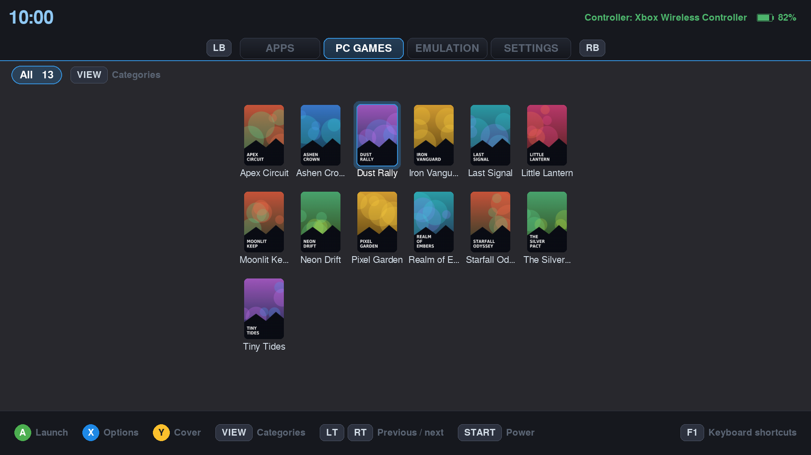
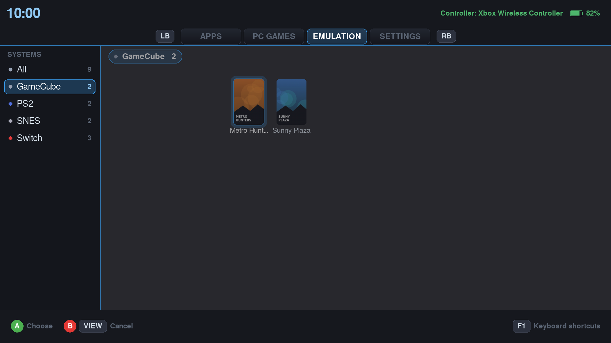
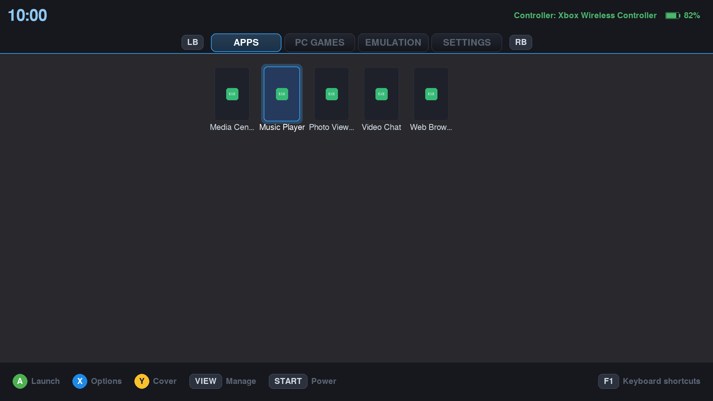
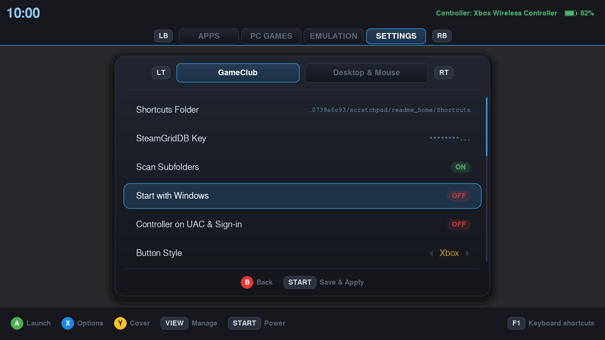
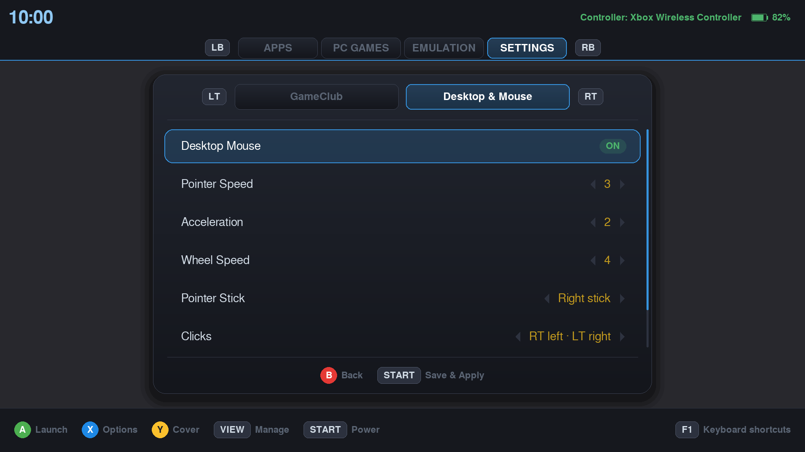
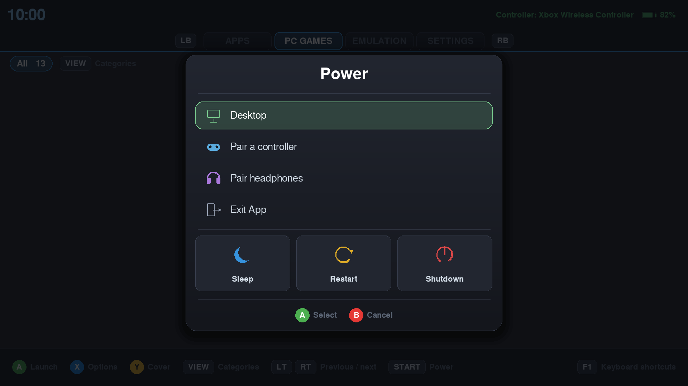
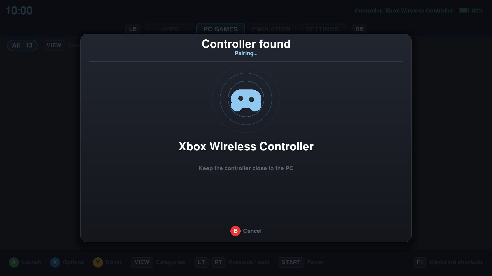
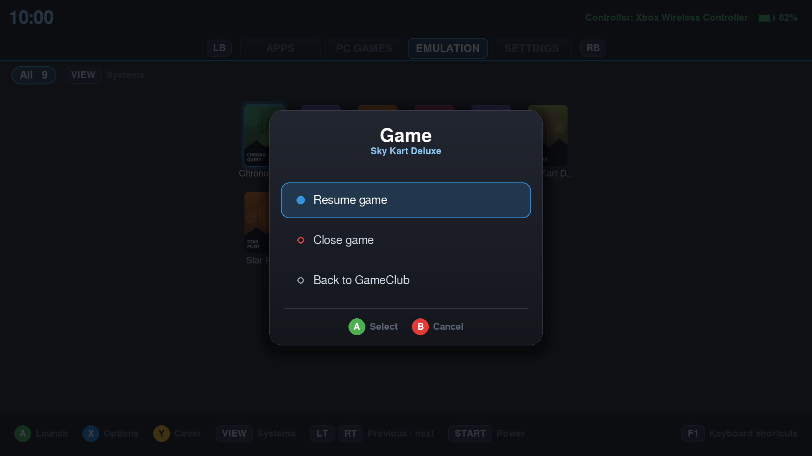

# GameClub

**A couch-friendly game launcher for Windows, built for a controller.**
Put your games, emulators and apps on one big-screen menu, launch them with the pad, and keep using the pad everywhere else in Windows — as a mouse, a keyboard, and even on UAC prompts.

> Free for personal and other noncommercial use — see [License](#license).



---

## Features

**Library**
- Three tabs — **Apps**, **PC Games**, **Emulation** — filled from a folder of shortcuts (`.lnk`, `.url`, `.exe`). GameClub guesses the right tab for each shortcut; you can move any of them with **X → Move to tab**.
- **Covers** from [SteamGridDB](https://www.steamgriddb.com/) (free API key), or pick your own with **Y**.
- **Categories rail** for PC Games and Emulation (**VIEW**): categories come from your subfolders (`Games\RPG\…`), Emulation systems are detected from the emulator or ROM type, and you can set them by hand (**X → Set category**).
- Sort orders per tab, play-time stats, accent colours, wallpaper background, Xbox / PlayStation / Nintendo button styles.

**While playing**
- Hold **VIEW + START** to come back to GameClub from any window.
- In an emulated game the same combo opens a **Game menu**: *Resume*, *Close game* (asks the emulator nicely first), *Back to GameClub*.
- The mouse pointer is hidden over full-screen games while you use the pad.

**Controller everywhere else**
- **Desktop mouse:** stick = pointer, other stick = scroll, triggers = clicks, D-pad = arrow keys. Turns itself off over full-screen games (but stays on for anything started from the Apps tab).
- **On-screen keyboard:** **VIEW + X** — for launcher logins and settings windows.
- **Controller on UAC & Sign-in** (optional): use the pad on UAC prompts and the sign-in screen.

**Devices**
- **Pair a controller** over Bluetooth with no keyboard: if GameClub starts and no controller is connected, it searches and pairs one by itself.
- **Pair headphones** from the Power menu — only headphones/headsets are paired, and sound switches to them.
- Controller **battery** in the top bar (exact % for Xbox pads and GameSir Cyclone 2 with the optional packages).

## Screenshots

| | |
|---|---|
|  |  |
|  |  |
|  |  |
|  | |

*(Covers in the screenshots are made-up placeholders.)*

## Install

1. Download **`GameClub_Setup.exe`** from the [Releases](https://github.com/stojadinovic771-boop/GameClub/releases) page and run it.
2. GameClub isn't code-signed, so Windows may warn you:
   - **SmartScreen** ("Windows protected your PC") → *More info* → *Run anyway*.
   - **Microsoft Defender** can flag new unsigned programs that register startup tasks. If that happens, you can report it as a false positive at [microsoft.com/wdsi/filesubmission](https://www.microsoft.com/wdsi/filesubmission) — or build GameClub yourself from source (below).
3. Start GameClub, open **Settings** (RB until you reach it), and set your **Shortcuts Folder**.

**Requirements:** Windows 10 or 11 (64-bit) and a controller (Xbox, PlayStation, Switch Pro, 8BitDo, GameSir… anything Windows sees as a gamepad). A keyboard works too.

## Setting up your shortcuts

Point GameClub at one folder of shortcuts. Subfolders are optional but help:

```
Shortcuts\
├─ Apps\              → Apps tab
├─ Games\             → PC Games tab
│  ├─ RPG\            → category "RPG"
│  └─ Racing\         → category "Racing"
└─ Emulation\         → Emulation tab
   ├─ Switch\         → system "Switch"
   └─ PS2\
```

Without subfolders, GameClub sorts shortcuts by what they point to (emulators and ROMs → Emulation, known apps → Apps, the rest → PC Games). Turn on **Scan Subfolders** in Settings to include nested folders.

## Controls

| Controller | Keyboard | In GameClub |
|---|---|---|
| D-pad / left stick | Arrow keys | Move |
| A | Enter | Launch / select |
| B | Backspace | Back / cancel |
| LB / RB | Shift+Tab / Tab | Switch tab |
| LT / RT | PgUp / PgDn | Previous / next category |
| X | X | Options (move, set category, manage) |
| Y | Y | Choose cover |
| VIEW | F2 | Categories rail (Apps tab: Manage) |
| START | Esc | Power menu |
| RS (press in) | S | Change sort order |
| — | F1 | Help (all shortcuts) |

Outside GameClub: **VIEW + START** (hold 1 s) to come back, **VIEW + X** for the on-screen keyboard. Press **F1** in GameClub for the full list.

## Build from source

You need Python 3.10+ and, for the installer, [NSIS](https://nsis.sourceforge.io/Download).

```
git clone https://github.com/stojadinovic771-boop/GameClub.git
cd GameClub
BUILD.bat
```

`BUILD.bat` installs the packages from `requirements.txt`, builds `dist\GameClub\GameClub.exe` with PyInstaller, then `GameClub_Setup.exe` with NSIS.

To just run it: `pip install -r requirements.txt` then `python gameclub.py`.
The packages marked optional in `requirements.txt` add battery % and Bluetooth pairing; GameClub works without them.

## Your data

Settings, covers and play stats are stored in your user folder (`.games_browser_config.json`, `.games_browser_sgdb\`, …). A diagnostic log is written to `~/games_browser_input_log.txt`. Nothing is sent anywhere except cover searches to SteamGridDB, and only if you enter your own API key.

## License

GameClub is licensed under the **[PolyForm Noncommercial License 1.0.0](LICENSE.md)**.

In short (the license text is what counts): you may use, copy, modify and share GameClub for **personal and other noncommercial purposes**, as long as you keep the license and the `Required Notice` line with it. **Commercial use is not allowed** without permission — [open an issue](https://github.com/stojadinovic771-boop/GameClub/issues) if you'd like to ask.

Required Notice: Copyright (c) 2026 Nikola Stojadinovic

---

GameClub is an independent project and is not affiliated with or endorsed by Microsoft, Sony, Nintendo, Valve, SteamGridDB or any controller maker. Product names are used only to describe compatibility.
